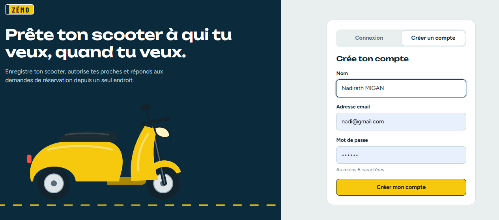
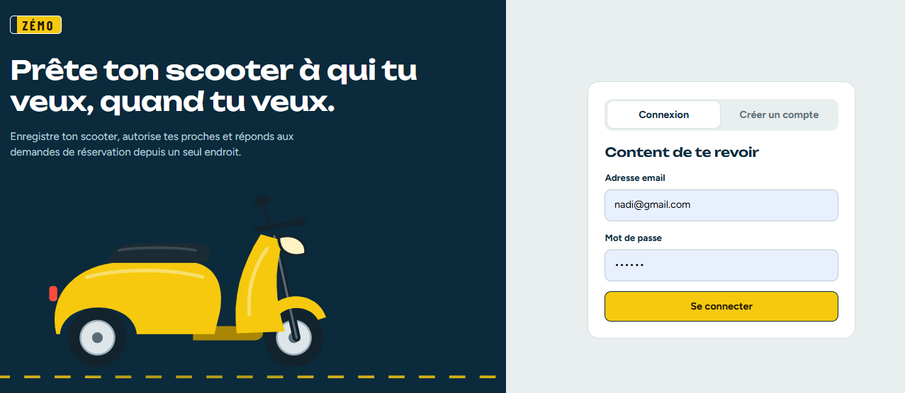
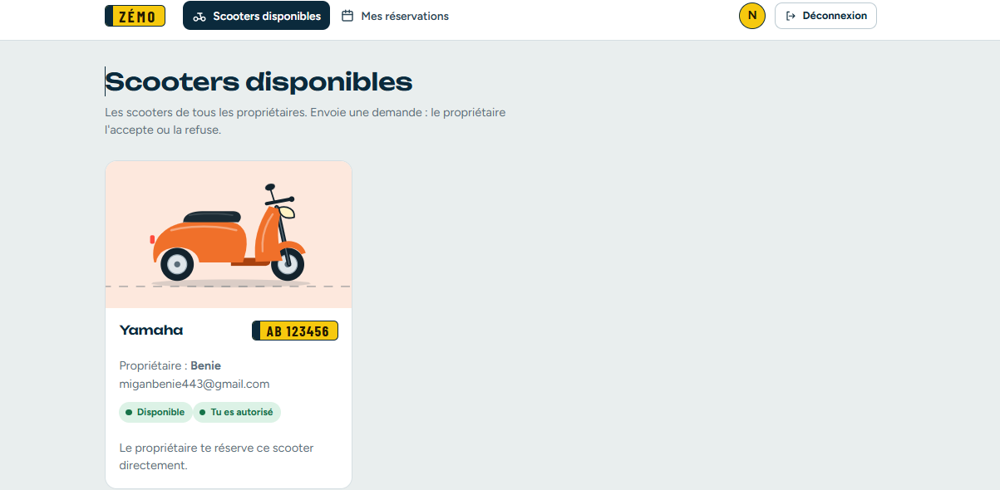
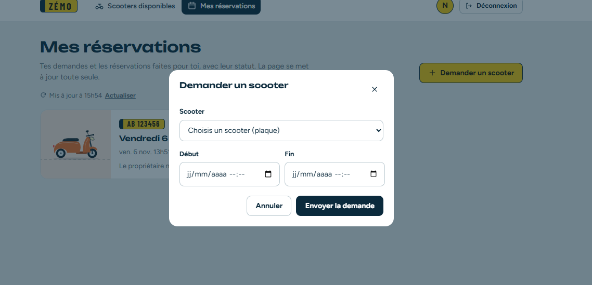
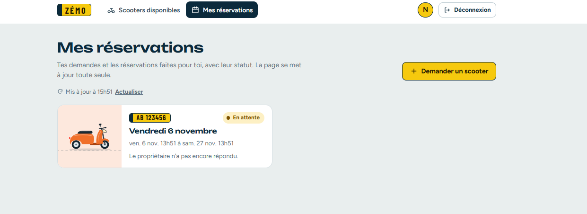
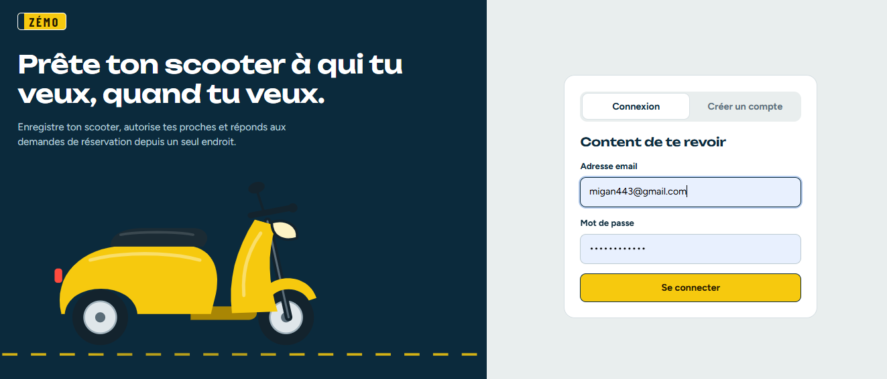
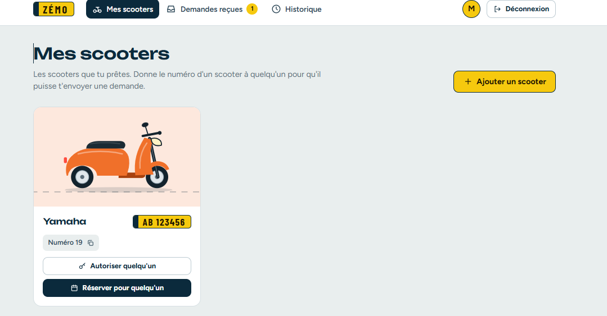
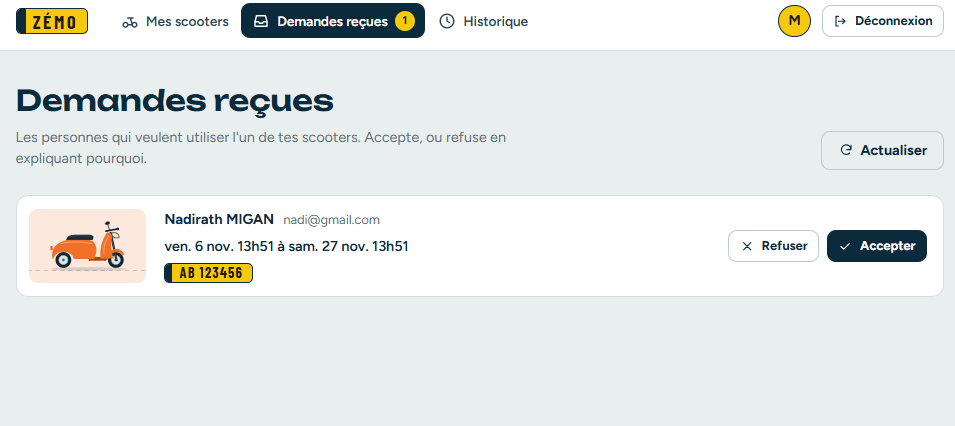
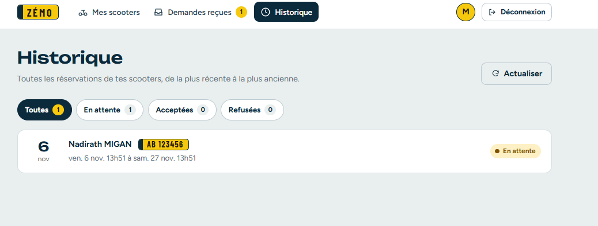

# 🛵 Projet Scooter

Application de gestion de scooters : location, suivi et administration.

## Aperçu

### Interface utilisateur simple
Inscription

Conexion

Scooters disponibles

Faire une demande

Statut de mes demandes

### Interface proprietaire
Le propriétaire gère les scooters, les clients et les reservations.

Connexion

Mes Scooters

Demandes de reservations recues

Historique

